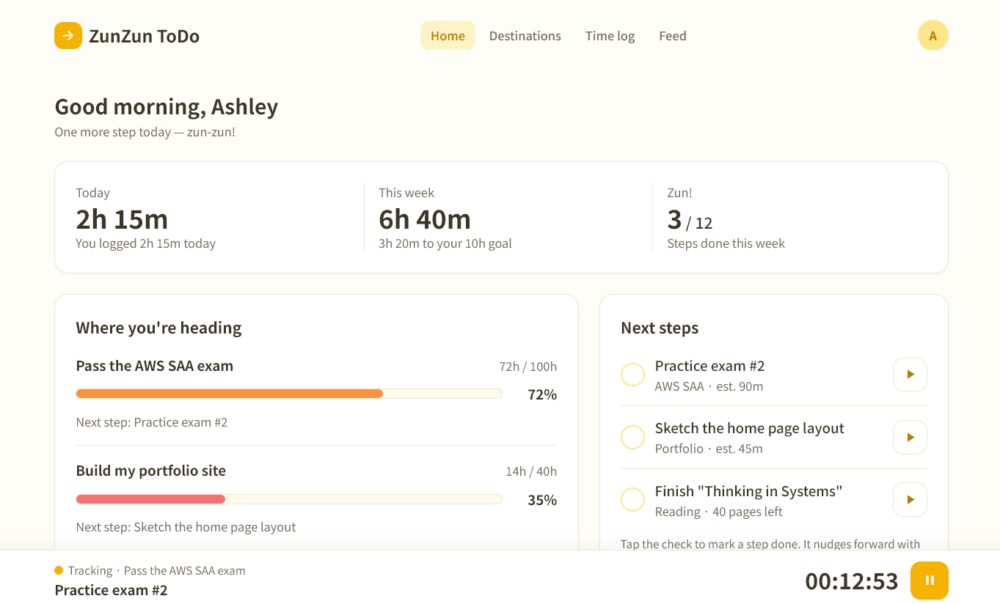
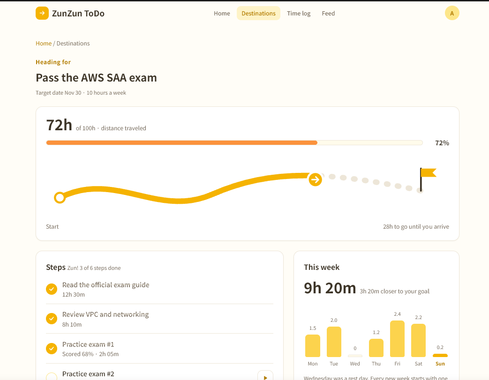
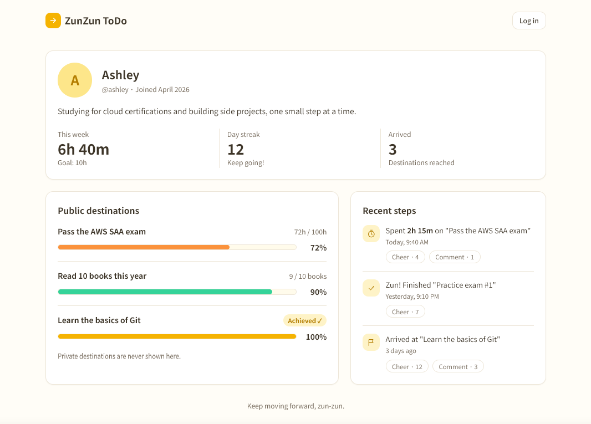
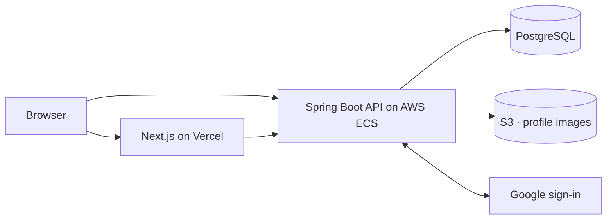

<div align="center">

# ずんずんToDo

## ZunZun ToDo

### Keep moving forward, zun-zun.

More than a to-do list: a goal planner, progress journal, and accountability community in one —
built to make your effort visible and to keep you moving toward the goals that matter.

**🚧 In active development** · [Design Specification](docs/design-specification.md) · [Implementation Plan](docs/implementation-plan.md)

</div>

---

## Why "ZunZun"?

**ずんずん (zun-zun)** is a Japanese onomatopoeia — a word that imitates a sound or a feeling. It describes moving forward steadily and energetically: the sound of someone striding ahead, step after step, without hesitating.

A big goal can feel impossibly far away. But you don't reach it in one leap — you reach it by taking the next small step, then the next, and not stopping. **That steady forward rhythm is zun-zun.** This app is built to give you that feeling every day.

| Zun-zun | In ZunZun ToDo |
|---|---|
| Where you are heading | Your big goal — a **Project** |
| Each stride | A small, achievable step — a **Task** |
| The distance behind you | The time and effort you have put in |
| People walking beside you | Friends who follow and cheer on your progress |

---

## The Problem

People lose motivation on long-term goals for three reasons:

- **Effort is invisible.** Hours of work leave no trace you can see.
- **Progress is hard to feel.** A distant goal barely seems to move from day to day.
- **Working alone is hard.** Without companions pursuing similar goals, it is easy to quit quietly.

ZunZun ToDo answers each one: it records your effort, visualizes your progress, and connects you with people moving forward alongside you.

---

## What ZunZun ToDo Does

**Break big goals into steps.** Create a Project for a large goal and split it into small Tasks you can actually finish.

**Record your progress on a calendar.** Today is always highlighted. Pick any day, note which tasks you completed or worked on, and add the time you spent if you like.

**See your effort.** Switch between all projects (bar chart) and a single project (line chart), between time and completed tasks, and between weekly and monthly views.

**Move forward together.** Tag your profile with interests, find people through hashtags, and follow them. When someone completes a public project, it appears on your home screen — react and leave a comment to cheer them on.

**Stay in control.** Every project is public or private, and your daily records are only ever visible to you.

---

## Planned UI

Design mockups of the screens being built. The app is still in development, so the final UI may differ.

**Home** — today's and this week's effort, how far along each goal is, and the next steps to take.



**Project detail** — the journey toward a goal, its steps, and this week's effort.



**Profile** — public projects, recent activity, and a place for friends to cheer you on.



---

## Future Plan

- **Mobile app** — a native Android client in Kotlin, built on the same API.

---

## Tech Stack

| Layer | Technology |
|---|---|
| Backend | Java 25, Spring Boot 3.5 (Web, Data JPA, Security, OAuth2), Maven |
| Database | PostgreSQL 17, Flyway |
| Frontend | Next.js (App Router), TypeScript, Tailwind CSS, TanStack Query, Recharts |
| Security | Google sign-in (OAuth 2.0 / OpenID Connect), JWT access tokens, rotating refresh tokens in HttpOnly cookies |
| Testing | JUnit 5, Mockito, Testcontainers (real PostgreSQL) |
| Infrastructure | Docker, GitHub Actions, Vercel, AWS (ECS Fargate, RDS, S3) — hosted in the EU (Paris) |

---

## Architecture



The frontend and backend communicate only through a versioned REST API (`/api/v1`), so the future mobile app can reuse the same backend. See the [Design Specification](docs/design-specification.md) for the data model, API, and UI design.

---

## Getting Started

**Prerequisites:** Docker, Java 25, Node.js 20+

```bash
# 1. Start PostgreSQL
docker compose up -d

# 2. Run the backend (http://localhost:8080)
cd backend && cp .env.example .env && ./mvnw spring-boot:run

# 3. Run the frontend (http://localhost:3000)
cd frontend && cp .env.local.example .env.local && npm install && npm run dev
```

Google sign-in needs a Google OAuth client ID and secret in `backend/.env`; email and password sign-in works without them.

**Tests:**

```bash
cd backend && ./mvnw test    # unit + integration tests against real PostgreSQL
```

---

## Documentation

| Document | Contents |
|---|---|
| [Design Specification](docs/design-specification.md) | Requirements, architecture, database schema, API, UI/UX |
| [Implementation Plan](docs/implementation-plan.md) | Day-by-day plan for version 1.0 |
| [AWS Deployment Plan](docs/aws-deploy-plan.md) | Deploying the backend to AWS in the EU |
| [Development Log](docs/dev-log.md) | Short notes after each work block |
| [Architecture Decisions](docs/adr/) | Key design choices and their reasoning |

---

## License

[MIT](LICENSE)
