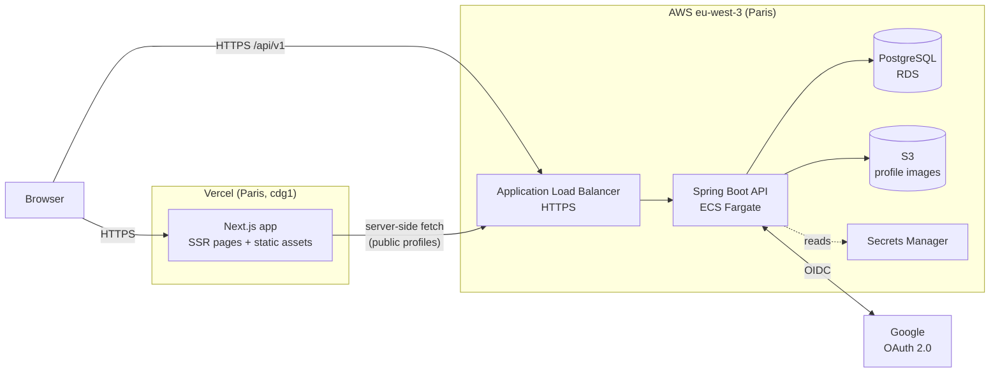
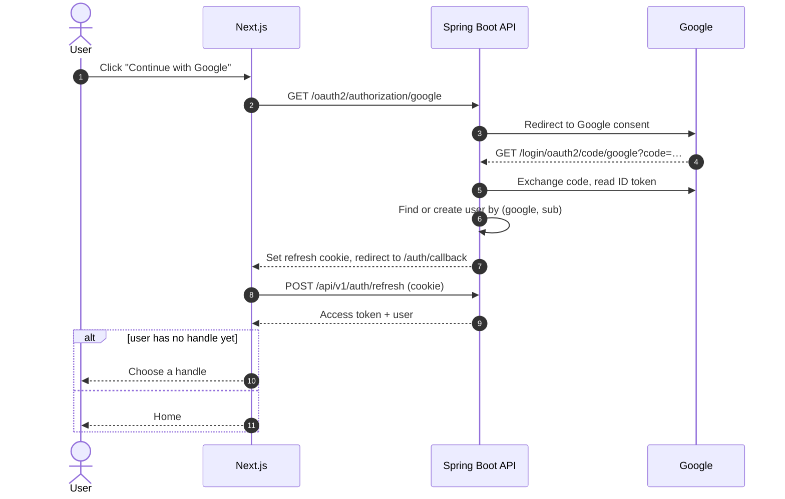
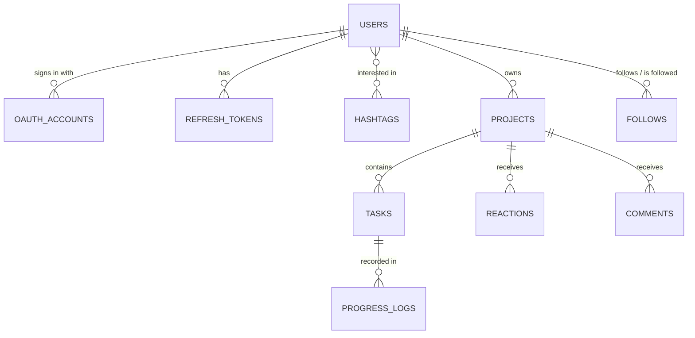

<div align="center">

# ずんずんToDo · ZunZun ToDo

### Keep moving forward, zun-zun.

*Software Design Specification*

</div>

---

## Revision History

| Version | Date | Author | Description |
|---|---|---|---|
| 1.0 | 2026-10-09 | Asuna Omizo | Initial version: projects and tasks, calendar-based progress logging, progress charts, profiles with hashtags, and social achievements |

---

## Table of Contents

1. [Introduction](#1-introduction)
2. [Functional Requirements](#2-functional-requirements)
3. [Non-Functional Requirements](#3-non-functional-requirements)
4. [User Stories](#4-user-stories)
5. [System Architecture](#5-system-architecture)
6. [Database Schema](#6-database-schema)
7. [REST API Design](#7-rest-api-design)
8. [UI/UX Design](#8-uiux-design)
9. [Release Scope and Future Plan](#9-release-scope-and-future-plan)
10. [Risks and Mitigations](#10-risks-and-mitigations)
- [Appendix A — Definitions](#appendix-a--definitions)
- [Appendix B — References](#appendix-b--references)

---

## 1. Introduction

### 1.1 Purpose and Scope

This document specifies the design of **ZunZun ToDo**, a web application that combines goal decomposition, daily progress logging, progress visualization, and social accountability.

**In scope:** requirements, architecture, data model, API contracts, and UI/UX direction for the web application (Next.js) and its backend (Spring Boot).
**Out of scope:** the mobile client (see §9.2), visual design assets, legal texts (privacy policy, terms of use), and operational runbooks.

### 1.2 Product Name

**ZunZun ToDo (ずんずんToDo) — *Keep moving forward, zun-zun.***

*Zun-zun* (ずんずん) is a Japanese onomatopoeia for moving forward steadily and energetically — the sound of someone striding ahead without hesitating. A big goal is rarely reached in one leap; it is reached by taking the next small step, then the next, and not stopping. ZunZun ToDo applies that feeling to personal goals: a large goal (a **Project**) is reached by steadily completing small, achievable steps (**Tasks**), and the progress you record shows how far you have come.

The same explanation is shown to users on the in-app **About** page (§8.4).

### 1.3 Problem Statement

People lose motivation on long-term goals because:

- their effort is invisible — work leaves no trace they can see;
- progress toward a distant goal is hard to feel from day to day;
- working alone, without companions pursuing similar goals, makes it easy to quit quietly.

### 1.4 Solution Overview

Users define large goals as **Projects** and break them into **Tasks**. Each day, they open a **calendar**, pick a date, and record which tasks they completed or worked on, optionally with the time spent. **Progress charts** turn those records into weekly and monthly views of time and completed tasks. Users can share projects publicly, follow each other, and when a public project is completed it appears as an **achievement** on followers' home screens and on the owner's profile, where others can react and comment.

### 1.5 Target Users

The first release targets English-speaking users in Europe. All infrastructure is hosted in the EU (§5.4).

| Persona | Description | Primary need |
|---|---|---|
| The Self-Learner | Studying for certifications or learning a language | See consistent daily effort |
| The Side-Project Builder | Developers, writers, artists with personal projects | Break a big goal into steps; share the finish |
| The Accountability Seeker | Works better when others can see progress | Find people with similar interests and cheer each other on |

### 1.6 Conventions

- Requirement IDs (`FR-<area>-<n>`, `NFR-<n>`) are stable once published.
- Priority: **M** = Must (required for v1.0), **S** = Should (included in v1.0 if time allows; first to cut).
- The key words *must*, *should*, and *may* follow RFC 2119.
- The OpenAPI document generated from the code is the binding API contract; examples here are illustrative.

### 1.7 Related Products

| Product | Focus | How ZunZun ToDo differs |
|---|---|---|
| Studyplus | Study logging with a learner community | Any long-term goal, not only study |
| Duolingo | Gamified language learning with streaks and leagues | User-defined goals (Project → Task) rather than a fixed curriculum; no leagues or rankings, encouragement-only social design |

---

## 2. Functional Requirements

### 2.1 Authentication and Account

| ID | Requirement | Priority |
|---|---|---|
| FR-AUTH-1 | Users can register with email, password, display name, and handle | M |
| FR-AUTH-2 | Users can sign in with email and password and receive a short-lived JWT access token and a rotating refresh token | M |
| FR-AUTH-3 | Users can sign in with Google (OAuth 2.0 / OpenID Connect) | M |
| FR-AUTH-4 | A user signing in with Google for the first time chooses a handle before entering the app | M |
| FR-AUTH-5 | Users can sign out; signing out revokes the refresh token | M |
| FR-AUTH-6 | Users can delete their account; all of their data is removed | M |

If an email address is already registered with a password, Google sign-in for that address is refused with a message asking the user to sign in with their password. Accounts are never linked automatically (see §5.5, decision 6).

### 2.2 Profile and Interests

| ID | Requirement | Priority |
|---|---|---|
| FR-PROF-1 | Users can edit display name, handle, and bio | M |
| FR-PROF-2 | Users can upload a profile image (JPEG, PNG, or WebP, at most 2 MB) and remove it | M |
| FR-PROF-3 | Users can tag their profile with up to 10 interest hashtags (e.g. `#languages`, `#marathon`) | M |
| FR-PROF-4 | Each user has a public profile page showing avatar, name, handle, bio, hashtags, follower and following counts, public active projects, and achievements | M |
| FR-PROF-5 | Users can search for people by handle, display name, or hashtag | M |

### 2.3 Projects and Tasks

| ID | Requirement | Priority |
|---|---|---|
| FR-PROJ-1 | Users can create, edit, and delete Projects (title, description, optional target date) | M |
| FR-PROJ-2 | Each Project is **Public** or **Private**; new projects default to Private | M |
| FR-PROJ-3 | A Project is **Active** or **Completed**. The owner marks it complete; it can be reopened | M |
| FR-PROJ-4 | Completion rate = completed tasks ÷ total tasks, shown on every project | M |
| FR-TASK-1 | Users can add, rename, reorder, and delete Tasks within a Project | M |
| FR-TASK-2 | A Task is **To do** or **Done** | M |
| FR-TASK-3 | Marking a task done from the project page records a completion for today (§2.4) | M |

### 2.4 Calendar and Progress Records

| ID | Requirement | Priority |
|---|---|---|
| FR-LOG-1 | The calendar shows one month at a time, with **today's date visually highlighted** | M |
| FR-LOG-2 | Days that have records are marked on the calendar | M |
| FR-LOG-3 | Selecting a date shows that day's records and the total time recorded | M |
| FR-LOG-4 | For a selected date, users can add a record: a task, whether it was **completed** or **worked on**, an optional duration (1 minute to 24 hours), and an optional note | M |
| FR-LOG-5 | Users can edit and delete their records | M |
| FR-LOG-6 | Records cannot be dated in the future (relative to the user's time zone) | M |
| FR-LOG-7 | A task has at most one completion record. Recording a completion marks the task Done; removing it marks the task To do | M |
| FR-LOG-8 | Records are private to their owner; they are never shown to other users | M |

### 2.5 Progress Charts

| ID | Requirement | Priority |
|---|---|---|
| FR-STAT-1 | Users choose the scope: **all projects** (bar chart) or **one project** (line chart) | M |
| FR-STAT-2 | Users choose the metric: **time** (hours) or **completed tasks** (count) | M |
| FR-STAT-3 | Users choose the period: **week** (Monday–Sunday) or **calendar month**, one value per day | M |
| FR-STAT-4 | Users can move to the previous or next period and return to the current one | M |
| FR-STAT-5 | The total for the displayed period is shown above the chart | M |

### 2.6 Social

| ID | Requirement | Priority |
|---|---|---|
| FR-SOC-1 | Users can follow and unfollow other users; following needs no approval | M |
| FR-SOC-2 | When a **public** project is completed, it becomes an **achievement** visible on the owner's profile | M |
| FR-SOC-3 | The home screen shows a feed of achievements from people the user follows, newest first | M |
| FR-SOC-4 | Signed-in users can react to an achievement with one of 👏 🔥 💪 🎉 ❤️, and remove their reaction | M |
| FR-SOC-5 | Signed-in users can comment on an achievement (at most 500 characters) | M |
| FR-SOC-6 | Comment authors can edit and delete their comments | M |
| FR-SOC-7 | The achievement's owner can delete any comment on it | M |
| FR-SOC-8 | If a project is made private or reopened, its achievement, reactions, and comments are hidden from others (the data is kept) | M |

### 2.7 About

| ID | Requirement | Priority |
|---|---|---|
| FR-ABOUT-1 | The app has an **About** tab explaining the meaning of *zun-zun* and the concept of the app; it is reachable whether or not the user is signed in | M |

---

## 3. Non-Functional Requirements

| ID | Category | Requirement |
|---|---|---|
| NFR-1 | Security | OWASP Top 10 mitigations; Spring Security on every endpoint; deny by default |
| NFR-2 | Security | Passwords hashed with bcrypt (cost 12); minimum length 10 characters |
| NFR-3 | Security | JWT access tokens expire after 15 minutes. Refresh tokens are opaque, stored hashed, rotated on every use, and revoked as a family when reuse is detected |
| NFR-4 | Security | The refresh token is sent only as an `HttpOnly`, `Secure`, `SameSite=Lax` cookie; cookie-based endpoints verify the `Origin` header against an allowlist |
| NFR-5 | Security | Sign-in and registration are rate-limited per IP address (10 requests per minute) |
| NFR-6 | Security | Uploaded images are validated by content (magic bytes), not by file name or declared type, and stored under random keys |
| NFR-7 | Security | Secrets live in AWS Secrets Manager in production and in an untracked `.env` file locally; nothing secret is committed |
| NFR-8 | Privacy | All data is stored in the EU. Account deletion removes the user's data and profile image. Only one strictly necessary cookie is used (the refresh token), so no consent banner is required |
| NFR-9 | Authorization | Every read or write of another user's data passes an ownership or visibility check, covered by integration tests |
| NFR-10 | Performance | p95 API latency under 300 ms at expected load; charts and calendar months load in a single request each |
| NFR-11 | Usability | Responsive from 360 px wide; keyboard-operable; WCAG 2.1 AA contrast; information is never conveyed by color alone |
| NFR-12 | Locale | English only. Dates shown as `9 Oct 2026`, 24-hour time, weeks start on Monday |
| NFR-13 | Maintainability | Layered, package-by-feature backend; service-layer logic covered by unit tests; integration tests run against real PostgreSQL (Testcontainers) |
| NFR-14 | Operability | Structured logs to CloudWatch; `/actuator/health` used by the load balancer |
| NFR-15 | Compatibility | Latest two versions of Chrome, Firefox, Safari, and Edge |
| NFR-16 | API | Versioned under `/api/v1` so a future mobile client can rely on a stable contract |

---

## 4. User Stories

**Account**
- *As a new user, I want to sign up with Google so that I can start without creating a password.*
  AC: after the first Google sign-in I am asked to choose a handle, then land on the home screen.
- *As a user, I want to delete my account so that my data does not stay online after I leave.*

**Projects and tasks**
- *As a user, I want to create a project and split it into tasks so that a big goal becomes manageable.*
- *As a user, I want to see each project's completion rate so that I know how far I have come.*

**Calendar**
- *As a user, I want to open the calendar and see today highlighted so that I can record today's progress immediately.*
  AC: the calendar opens on the current month with today selected; today is visually distinct even when another date is selected.
- *As a user, I want to record that I completed a task yesterday, with the time I spent, so that my records stay accurate when I forget to log on the day.*
  AC: past dates can be selected; future dates cannot; the task becomes Done.
- *As a user, I want to record that I worked on a task without finishing it so that partial effort counts too.*

**Progress charts**
- *As a user, I want to see a bar chart of time across all projects for this week so that I can see my consistency.*
- *As a user, I want a line chart of completed tasks in one project this month so that I can see that project moving forward.*

**Social**
- *As a user, I want to tag my profile with interests and search others by hashtag so that I can find people with similar goals.*
- *As a follower, I want to see friends' completed projects on my home screen so that I can congratulate them.*
- *As a follower, I want to react and comment on an achievement so that I can encourage the person.*
- *As the owner of an achievement, I want to delete inappropriate comments on it so that my page stays positive.*

**About**
- *As a visitor, I want to read what "zun-zun" means so that I understand the idea behind the app.*

---

## 5. System Architecture

### 5.1 Overview



The frontend (`zunzuntodo.app`) and the API (`api.zunzuntodo.app`) share one registrable domain, so the refresh-token cookie is same-site (§5.5, decision 5). The browser calls the API directly; public profile pages are rendered on the server by Next.js for search engines and link previews.

### 5.2 Technology Stack

| Layer | Technology | Notes |
|---|---|---|
| Language | Java 25 | Latest Java version supported by Spring Boot 3.5 |
| Framework | Spring Boot 3.5.x | Web, Data JPA, Security, OAuth2 Client, OAuth2 Resource Server (JWT), Validation, Actuator |
| Build | Maven (with Maven Wrapper `./mvnw`) | |
| Database | PostgreSQL 17, Flyway migrations | |
| Mapping / docs | MapStruct, springdoc-openapi | |
| Storage | AWS SDK v2 (S3) | Local file storage in development |
| Rate limiting | Bucket4j (in memory) | Sufficient for a single API instance |
| Frontend | Next.js (App Router), TypeScript, Tailwind CSS, TanStack Query, Recharts, date-fns | |
| Testing | JUnit 5, Mockito, Testcontainers (PostgreSQL), Spring Security Test | |
| CI/CD | GitHub Actions | Backend deploys to ECS; frontend deploys through Vercel |
| Hosting | Vercel (frontend), AWS eu-west-3 (backend) | |

### 5.3 Backend Structure

Package-by-feature; each feature package holds its own controller, service, repository, entities, DTOs, and mapper.

```
com.zunzuntodo
├── config/        # Security, CORS, OpenAPI, storage configuration
├── common/        # Error handling (RFC 7807), pagination, utilities
├── auth/          # Registration, sign-in, JWT, refresh tokens, Google OAuth handlers
├── user/          # Profile, avatar, hashtags, search
├── project/       # Projects and completion
├── task/          # Tasks
├── progress/      # Progress records (calendar)
├── stats/         # Chart data
└── social/        # Follows, feed, reactions, comments
```

Controllers return DTOs only; entities never leave the service layer.

### 5.4 Hosting in the EU

| Component | Location |
|---|---|
| API, database, images | AWS **eu-west-3 (Paris)** |
| Frontend | Vercel, function region **cdg1 (Paris)** |

### 5.5 Key Design Decisions

1. **Progress records are the single source of truth for charts.** Both chart metrics come from `progress_logs`: time is the sum of `minutes`, and completed tasks is the count of records with `completed = true`. No separate counters exist, so the charts cannot drift from the calendar.
2. **Task completion is a record.** Marking a task done (on the calendar or the project page) creates or updates its completion record; undoing it removes the flag. A partial unique index enforces at most one completion per task. This keeps the task's status, the calendar, and the charts consistent.
3. **Charts are computed with SQL `GROUP BY log_date`.** At the expected scale a precomputed summary table is unnecessary; an index on `(user_id, log_date)` keeps queries fast. The API fills days without records with zero.
4. **Achievements are derived, not stored.** An achievement is a project that is `PUBLIC` and `COMPLETED`. The feed is a query over followed users' projects ordered by `completed_at`; no event table is needed. Making a project private or reopening it hides the achievement automatically.
5. **Refresh token in a same-site cookie, access token in memory.** The access token is held in JavaScript memory and sent as a bearer token; the refresh token is an `HttpOnly` cookie. Because the frontend and API share `zunzuntodo.app`, the cookie is same-site and not affected by third-party cookie blocking. Vercel preview URLs (`*.vercel.app`) are cross-site, so sign-in persistence is not supported on previews.
6. **No automatic account linking.** Password accounts are not email-verified in v1.0, so linking a Google sign-in to an existing account by email could let someone pre-register a victim's address. Google sign-in for an address that already has a password account is refused.
7. **Image storage behind an interface.** `ImageStorage` has a local file implementation for development and an S3 implementation for production. Profile responses include a time-limited presigned URL for the image.
8. **Dates, not timestamps, for records.** `log_date` is a `DATE` chosen by the user, so no time-zone conversion is applied to it. The user's time zone is used only to decide what "today" is when rejecting future dates and when opening the calendar.

### 5.6 Google Sign-in Flow



---

## 6. Database Schema

### 6.1 Entity Relationships



### 6.2 Tables

```sql
CREATE TABLE users (
  id             BIGINT GENERATED ALWAYS AS IDENTITY PRIMARY KEY,
  email          VARCHAR(254) NOT NULL UNIQUE,
  password_hash  VARCHAR(100),                       -- NULL for Google-only accounts
  handle         VARCHAR(20)  UNIQUE,                -- NULL until chosen after first Google sign-in
  display_name   VARCHAR(50)  NOT NULL,
  bio            VARCHAR(300),
  avatar_key     VARCHAR(200),
  time_zone      VARCHAR(50)  NOT NULL DEFAULT 'Europe/Paris',
  created_at     TIMESTAMPTZ  NOT NULL DEFAULT now(),
  updated_at     TIMESTAMPTZ  NOT NULL DEFAULT now(),
  CONSTRAINT chk_handle_format CHECK (handle ~ '^[a-z0-9_]{3,20}$')
);

CREATE TABLE oauth_accounts (
  id                BIGINT GENERATED ALWAYS AS IDENTITY PRIMARY KEY,
  user_id           BIGINT NOT NULL REFERENCES users(id) ON DELETE CASCADE,
  provider          VARCHAR(20)  NOT NULL,           -- 'GOOGLE'
  provider_user_id  VARCHAR(100) NOT NULL,           -- OIDC "sub"
  created_at        TIMESTAMPTZ  NOT NULL DEFAULT now(),
  UNIQUE (provider, provider_user_id)
);

CREATE TABLE refresh_tokens (
  id          BIGINT GENERATED ALWAYS AS IDENTITY PRIMARY KEY,
  user_id     BIGINT NOT NULL REFERENCES users(id) ON DELETE CASCADE,
  family_id   UUID NOT NULL,                         -- all rotations of one sign-in
  token_hash  CHAR(64) NOT NULL UNIQUE,              -- SHA-256, hex
  expires_at  TIMESTAMPTZ NOT NULL,
  used_at     TIMESTAMPTZ,                           -- set when rotated
  revoked_at  TIMESTAMPTZ,
  created_at  TIMESTAMPTZ NOT NULL DEFAULT now()
);
CREATE INDEX idx_refresh_tokens_family ON refresh_tokens(family_id);

CREATE TABLE hashtags (
  id    BIGINT GENERATED ALWAYS AS IDENTITY PRIMARY KEY,
  name  VARCHAR(30) NOT NULL UNIQUE,                 -- lowercase, without '#'
  CONSTRAINT chk_hashtag_format CHECK (name ~ '^[a-z0-9_]{1,30}$')
);

CREATE TABLE user_hashtags (
  user_id     BIGINT NOT NULL REFERENCES users(id) ON DELETE CASCADE,
  hashtag_id  BIGINT NOT NULL REFERENCES hashtags(id) ON DELETE CASCADE,
  PRIMARY KEY (user_id, hashtag_id)
);
CREATE INDEX idx_user_hashtags_hashtag ON user_hashtags(hashtag_id);

CREATE TABLE projects (
  id            BIGINT GENERATED ALWAYS AS IDENTITY PRIMARY KEY,
  owner_id      BIGINT NOT NULL REFERENCES users(id) ON DELETE CASCADE,
  title         VARCHAR(120) NOT NULL,
  description   VARCHAR(2000),
  visibility    VARCHAR(10)  NOT NULL DEFAULT 'PRIVATE' CHECK (visibility IN ('PUBLIC','PRIVATE')),
  status        VARCHAR(10)  NOT NULL DEFAULT 'ACTIVE'  CHECK (status IN ('ACTIVE','COMPLETED')),
  target_date   DATE,
  completed_at  TIMESTAMPTZ,
  created_at    TIMESTAMPTZ NOT NULL DEFAULT now(),
  updated_at    TIMESTAMPTZ NOT NULL DEFAULT now(),
  version       INTEGER NOT NULL DEFAULT 0,
  CONSTRAINT chk_completed_at CHECK ((status = 'COMPLETED') = (completed_at IS NOT NULL))
);
CREATE INDEX idx_projects_owner ON projects(owner_id);
CREATE INDEX idx_projects_achievements ON projects(owner_id, completed_at DESC)
  WHERE visibility = 'PUBLIC' AND status = 'COMPLETED';

CREATE TABLE tasks (
  id          BIGINT GENERATED ALWAYS AS IDENTITY PRIMARY KEY,
  project_id  BIGINT NOT NULL REFERENCES projects(id) ON DELETE CASCADE,
  owner_id    BIGINT NOT NULL REFERENCES users(id) ON DELETE CASCADE,  -- denormalized for ownership checks
  title       VARCHAR(200) NOT NULL,
  status      VARCHAR(10)  NOT NULL DEFAULT 'TODO' CHECK (status IN ('TODO','DONE')),
  sort_order  INTEGER NOT NULL DEFAULT 0,
  created_at  TIMESTAMPTZ NOT NULL DEFAULT now(),
  updated_at  TIMESTAMPTZ NOT NULL DEFAULT now(),
  version     INTEGER NOT NULL DEFAULT 0
);
CREATE INDEX idx_tasks_project ON tasks(project_id, sort_order);

CREATE TABLE progress_logs (
  id          BIGINT GENERATED ALWAYS AS IDENTITY PRIMARY KEY,
  user_id     BIGINT NOT NULL REFERENCES users(id) ON DELETE CASCADE,
  project_id  BIGINT NOT NULL REFERENCES projects(id) ON DELETE CASCADE,  -- denormalized for chart queries
  task_id     BIGINT NOT NULL REFERENCES tasks(id) ON DELETE CASCADE,
  log_date    DATE NOT NULL,
  minutes     INTEGER CHECK (minutes BETWEEN 1 AND 1440),               -- optional
  completed   BOOLEAN NOT NULL DEFAULT FALSE,
  note        VARCHAR(280),
  created_at  TIMESTAMPTZ NOT NULL DEFAULT now(),
  updated_at  TIMESTAMPTZ NOT NULL DEFAULT now()
);
CREATE INDEX idx_logs_user_date    ON progress_logs(user_id, log_date);
CREATE INDEX idx_logs_project_date ON progress_logs(project_id, log_date);
CREATE UNIQUE INDEX uq_logs_one_completion_per_task ON progress_logs(task_id) WHERE completed;

CREATE TABLE follows (
  follower_id  BIGINT NOT NULL REFERENCES users(id) ON DELETE CASCADE,
  followee_id  BIGINT NOT NULL REFERENCES users(id) ON DELETE CASCADE,
  created_at   TIMESTAMPTZ NOT NULL DEFAULT now(),
  PRIMARY KEY (follower_id, followee_id),
  CONSTRAINT chk_no_self_follow CHECK (follower_id <> followee_id)
);
CREATE INDEX idx_follows_followee ON follows(followee_id);

CREATE TABLE reactions (
  project_id  BIGINT NOT NULL REFERENCES projects(id) ON DELETE CASCADE,
  user_id     BIGINT NOT NULL REFERENCES users(id) ON DELETE CASCADE,
  emoji       VARCHAR(10) NOT NULL CHECK (emoji IN ('CLAP','FIRE','MUSCLE','PARTY','HEART')),
  created_at  TIMESTAMPTZ NOT NULL DEFAULT now(),
  PRIMARY KEY (project_id, user_id, emoji)
);

CREATE TABLE comments (
  id          BIGINT GENERATED ALWAYS AS IDENTITY PRIMARY KEY,
  project_id  BIGINT NOT NULL REFERENCES projects(id) ON DELETE CASCADE,
  author_id   BIGINT NOT NULL REFERENCES users(id) ON DELETE CASCADE,
  body        VARCHAR(500) NOT NULL,
  edited      BOOLEAN NOT NULL DEFAULT FALSE,
  created_at  TIMESTAMPTZ NOT NULL DEFAULT now(),
  updated_at  TIMESTAMPTZ NOT NULL DEFAULT now()
);
CREATE INDEX idx_comments_project ON comments(project_id, created_at);
```

### 6.3 Schema Notes

- Emoji are stored as codes (`CLAP` → 👏, `FIRE` → 🔥, `MUSCLE` → 💪, `PARTY` → 🎉, `HEART` → ❤️) so the database never depends on emoji encoding.
- `uq_logs_one_completion_per_task` guarantees a task is completed at most once, even under concurrent requests.
- `chk_completed_at` keeps a project's status and completion time consistent.
- Durations are whole **minutes**; conversion to hours happens only in the UI.
- Account deletion relies on `ON DELETE CASCADE` from `users`; the profile image is deleted from storage in the same service call.

---

## 7. REST API Design

Base URL `https://api.zunzuntodo.app/api/v1` · JSON · `Authorization: Bearer <access token>` unless stated · errors as RFC 7807 `application/problem+json` · list endpoints paginate with `?page=&size=` (feed uses a cursor).

### 7.1 Authentication

| Method | Path | Description |
|---|---|---|
| POST | `/auth/register` | Create a password account; returns access token and sets refresh cookie |
| POST | `/auth/login` | Password sign-in; returns access token and sets refresh cookie |
| POST | `/auth/refresh` | Rotates the refresh cookie; returns a new access token and the current user (cookie auth, `Origin` checked) |
| POST | `/auth/logout` | Revokes the refresh token family and clears the cookie |
| GET | `/oauth2/authorization/google` | Starts Google sign-in (outside `/api/v1`, handled by Spring Security) |

### 7.2 Users, Profiles, and Hashtags

| Method | Path | Description |
|---|---|---|
| GET | `/users/me` | Current user |
| PATCH | `/users/me` | Update display name, handle, bio, time zone |
| DELETE | `/users/me` | Delete account and all data |
| PUT | `/users/me/avatar` | Upload profile image (`multipart/form-data`) |
| DELETE | `/users/me/avatar` | Remove profile image |
| PUT | `/users/me/hashtags` | Replace hashtags, e.g. `{"hashtags":["languages","marathon"]}` (max 10) |
| GET | `/users/{handle}` | Public profile (no auth required) |
| GET | `/users/{handle}/projects` | Public projects: active ones with completion rate, and achievements (no auth required) |
| GET | `/users/{handle}/followers` · `/following` | Paginated lists |
| GET | `/users/search?q=&hashtag=` | Search by handle/name or by hashtag |

### 7.3 Projects and Tasks

| Method | Path | Description |
|---|---|---|
| GET | `/projects?status=ACTIVE\|COMPLETED` | My projects with completion rate |
| POST | `/projects` | Create |
| GET · PATCH · DELETE | `/projects/{id}` | Read, update (title, description, target date, visibility), delete |
| POST | `/projects/{id}/complete` | Mark completed |
| POST | `/projects/{id}/reopen` | Return to active |
| GET | `/projects/{id}/tasks` | Tasks in order |
| POST | `/projects/{id}/tasks` | Add task |
| PATCH · DELETE | `/tasks/{id}` | Rename or reorder; delete |
| PUT | `/tasks/{id}/completion` | Mark done; body `{"date":"2026-10-09"}` (defaults to today) |
| DELETE | `/tasks/{id}/completion` | Mark to do again |

### 7.4 Progress Records

| Method | Path | Description |
|---|---|---|
| GET | `/logs?from=2026-10-01&to=2026-10-31` | My records in a date range (at most 62 days) |
| POST | `/logs` | `{"taskId":12,"date":"2026-10-09","completed":true,"minutes":45,"note":"…"}` |
| PATCH · DELETE | `/logs/{id}` | Edit or delete one of my records |

Errors: `422` for a future date or an invalid duration; `409` when recording a second completion for the same task.

### 7.5 Statistics

| Method | Path | Description |
|---|---|---|
| GET | `/stats/progress` | Chart data |

Parameters: `metric=MINUTES|COMPLETED_TASKS`, `period=WEEK|MONTH`, `date=<any date in the period>`, optional `projectId`.

```json
{
  "metric": "MINUTES",
  "period": "WEEK",
  "from": "2026-10-05",
  "to": "2026-10-11",
  "projectId": null,
  "total": 415,
  "points": [
    { "date": "2026-10-05", "value": 60 },
    { "date": "2026-10-06", "value": 0 },
    { "date": "2026-10-07", "value": 95 },
    { "date": "2026-10-08", "value": 120 },
    { "date": "2026-10-09", "value": 140 },
    { "date": "2026-10-10", "value": 0 },
    { "date": "2026-10-11", "value": 0 }
  ]
}
```

### 7.6 Social

| Method | Path | Description |
|---|---|---|
| POST · DELETE | `/users/{handle}/follow` | Follow / unfollow |
| GET | `/feed?cursor=` | Achievements of followed users, newest first |
| PUT · DELETE | `/projects/{id}/reactions/{emoji}` | Add / remove my reaction (idempotent) |
| GET | `/projects/{id}/comments` | Comments on an achievement (no auth required) |
| POST | `/projects/{id}/comments` | Add a comment |
| PATCH · DELETE | `/comments/{id}` | Edit (author) / delete (author or achievement owner) |

Reactions and comments are accepted only for projects that are `PUBLIC` and `COMPLETED`; for anything else the API responds `404` to non-owners, so it does not reveal that a private project exists.

---

## 8. UI/UX Design

### 8.1 Principles

1. **Recording progress takes seconds.** The calendar opens on today; adding a record is one short form.
2. **Effort is visible.** Numbers are large; charts and completion rates are always one tap away.
3. **Encouragement only.** No rankings, no dislikes, no follower leaderboards.
4. **Privacy is explicit.** Every project shows 🌐 Public or 🔒 Private; records are never shared.

### 8.2 Navigation

| Tab | Content |
|---|---|
| **Home** | Today at a glance (records today, active projects) and the feed of followed users' achievements |
| **Calendar** | Month calendar and the selected day's records |
| **Projects** | Project list; project detail with tasks |
| **Progress** | Charts |
| **People** | Search by name, handle, or hashtag |
| **About** | Meaning of *zun-zun* and the concept of the app |

Desktop: top navigation with all six tabs and an avatar menu (Profile, Settings, Sign out). Mobile: a bottom bar with Home, Calendar, Projects, Progress, People; About is an ⓘ button in the header. Signed-out visitors can open About and public profiles.

### 8.3 Screens

| Screen | Contents |
|---|---|
| Sign in / Sign up | "Continue with Google" button, email and password form, tagline |
| Choose handle | Shown once after first Google sign-in |
| Home | "Today": records today and minutes recorded, button to the calendar · Feed: achievement cards (avatar, name, project title, task count, completion date, reactions, comment count) |
| Calendar | See §8.5 |
| Projects | Active and Completed tabs; each card shows title, 🌐/🔒, completion rate bar, target date |
| Project detail | Title, description, visibility toggle, completion rate, task list with checkboxes and reordering, "Mark project complete" / "Reopen" |
| Progress | See §8.6 |
| People | Search box; hashtag chips; result cards with Follow button |
| Profile (public) | Avatar, name, @handle, bio, hashtags, follower/following counts, Follow button, public active projects, achievements with reactions and comments |
| Settings | Profile fields, image upload, hashtags, time zone, delete account |
| About | See §8.4 |

### 8.4 About Page

The About page contains the same explanation as the README section *Why "ZunZun"?*:

- what **ずんずん (zun-zun)** means — a Japanese onomatopoeia for striding steadily forward;
- why it fits personal goals — big goals are reached step after step, without stopping;
- how the app maps to the idea — Project = where you are heading, Task = each stride, records = the distance behind you, followers = people walking beside you;
- the tagline *Keep moving forward, zun-zun.*

### 8.5 Calendar

- Month grid, weeks starting on Monday, previous/next month buttons and a **Today** button.
- **Today** is always highlighted: the date number sits in a filled goldenrod circle with bold white text and an accessible label ("Today"), even when another date is selected.
- The **selected** date has a goldenrod outline ring.
- Days with records show a small dot below the number; a filled check mark is shown when a task was completed that day.
- Future dates are muted and cannot be selected for new records.
- The day panel (beside the grid on desktop, a bottom sheet on mobile) lists the day's records grouped by project, with the total time, and an **Add record** form: Project → Task → *Completed* / *Worked on* → time (hours and minutes, optional) → note (optional).

### 8.6 Progress Charts

- Controls: **Scope** (All projects / a project selector), **Metric** (Time / Completed tasks), **Period** (Week / Month) with ‹ › navigation and a period label (`5–11 Oct 2026`, `October 2026`).
- All projects → **bar chart**; one project → **line chart**. One value per day; days without records show zero.
- Time is shown in hours with one decimal; completed tasks as whole numbers.
- The period total appears above the chart in large type (e.g. *6.9 h this week*).
- An empty period shows a friendly message and a link to the calendar.

### 8.7 Visual Identity

Bright, warm, and welcoming, built on **goldenrod (yamabuki, `#F5B301`) and white**: a warm cream page background (`#FFFDF7`), white cards, warm dark-brown text (`#3D3528`) instead of black, generous rounding, and soft shadows. Goldenrod is reserved for primary actions, today's date, and progress. The full token set is defined in `.claude/skills/frontend-feature/SKILL.md`.

### 8.8 Tone

Encouraging and never scolding. Celebrate effort and small steps: "One more step today — zun-zun!", "You recorded 2 h 15 min today". Completing a task shows a short "Zun!" with a small forward-bounce animation (disabled when the user prefers reduced motion).

---

## 9. Release Scope and Future Plan

### 9.1 Version 1.0

Everything in §2 marked **M**: email/password and Google sign-in, profiles with images and hashtags, projects and tasks, calendar-based progress records, progress charts, follow, feed, reactions, comments, About page, deployed on Vercel and AWS (EU).

### 9.2 Future Plan

- **Mobile app** — a native Android client (Kotlin) using the same `/api/v1` API.
- **Blocking users** — on hold for v1.0.

---

## 10. Risks and Mitigations

| Risk | Mitigation |
|---|---|
| Two-week schedule slips | Daily vertical slices; a fixed cut list in the implementation plan; the core loop (calendar + charts) is finished first |
| No password reset or email verification in v1.0 (they require transactional email) | Google sign-in is the recommended option on the sign-in page; accounts are never auto-linked by email (§5.5) |
| Cookie-based refresh fails across domains | Frontend and API share `zunzuntodo.app`; previews on `*.vercel.app` are documented as not supporting persistent sign-in |
| Inappropriate comments | Owners can delete comments on their achievements |
| AWS costs | Smallest instance sizes, single AZ, budget alert created first, environment can be stopped when idle |
| Spring Boot 3.5 open-source support ended on 30 June 2026 | Track the Spring Boot 4 migration as the first post-release task |

---

## Appendix A — Definitions

| Term | Definition |
|---|---|
| Project | A user's large goal, containing tasks |
| Task | A small, achievable step within a project |
| Progress record | An entry on a calendar date saying a task was completed or worked on, with optional time and note |
| Achievement | A project that is both public and completed |
| Completion rate | Done tasks ÷ total tasks of a project |
| Handle | Unique public user name (`@handle`) |

## Appendix B — References

1. Spring Boot 3.5 System Requirements — https://docs.spring.io/spring-boot/3.5/system-requirements.html
2. Spring Security Reference — https://docs.spring.io/spring-security/reference/
3. PostgreSQL Documentation — https://www.postgresql.org/docs/
4. Flyway Documentation — https://documentation.red-gate.com/flyway
5. Next.js Documentation — https://nextjs.org/docs
6. RFC 7807: Problem Details for HTTP APIs — https://datatracker.ietf.org/doc/html/rfc7807
7. RFC 2119: Key words for use in RFCs — https://datatracker.ietf.org/doc/html/rfc2119
8. OWASP Top 10 — https://owasp.org/Top10/
9. WCAG 2.1 — https://www.w3.org/TR/WCAG21/

---

<div align="center">
<sub>ZunZun ToDo SDS v1.0 · Last updated 2026-10-09 · Maintained in <code>docs/design-specification.md</code></sub>
</div>
